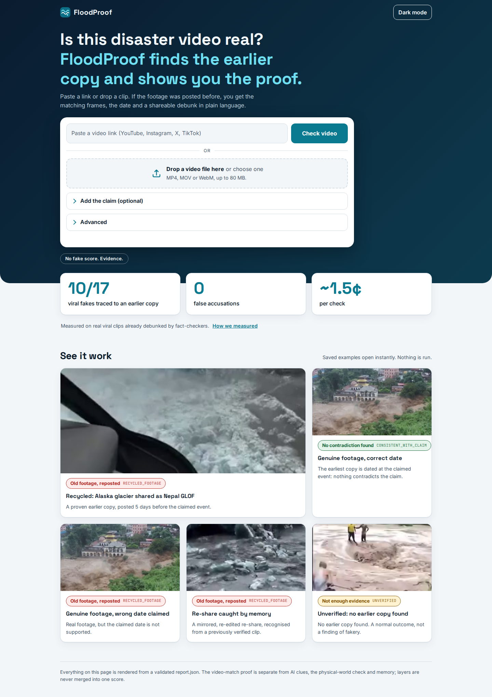
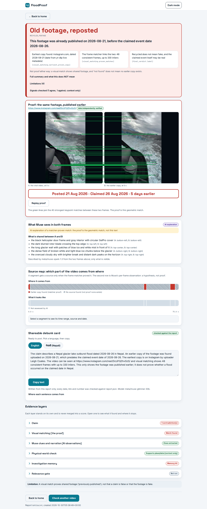
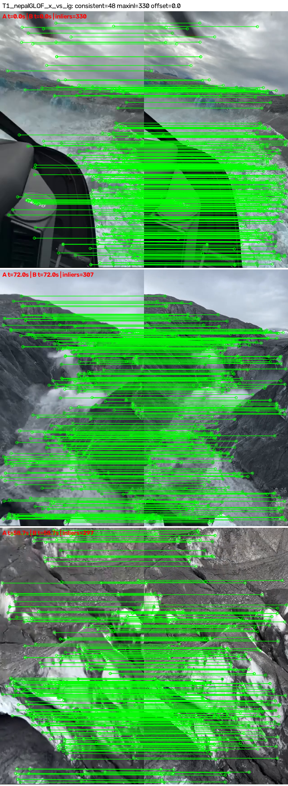
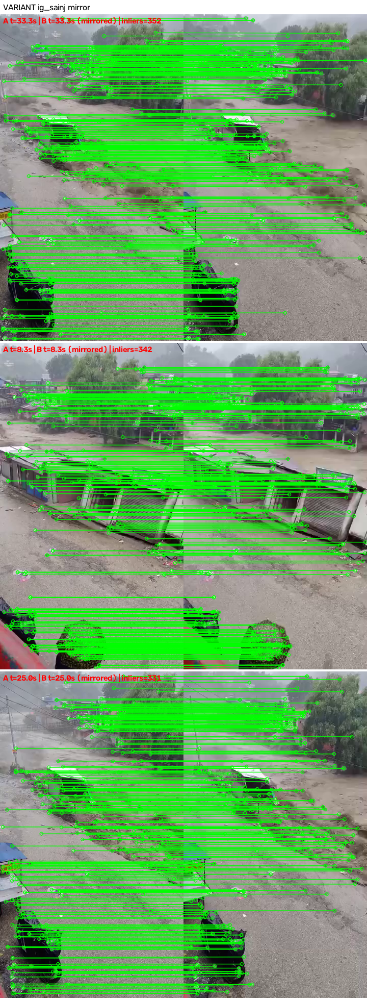

<div align="center">


# FloodProof

### Where did this disaster video really come from?

Give it a video and the claim: it finds earlier copies, proves the match frame by frame and checks the date.

<p>
<a href="https://floodproof.aether-soft.tech"></a>
<!-- VIDEO_BADGE -->
<a href="LICENSE"></a>
<a href="https://github.com/premanand8800/floodproof/actions/workflows/tests.yml"></a>
</p>
<p>
<a href="https://ai.meta.com/"></a>
<a href="https://www.baseten.co/"></a>
<a href="https://ai.meta.com/"></a>
<a href="https://ai.meta.com/"></a>
<a href="https://openrouter.ai/"></a>
<a href="https://www.python.org/"></a>
<a href="https://fastapi.tiangolo.com/"></a>
<a href="https://opencv.org/"></a>
<a href="https://github.com/yt-dlp/yt-dlp"></a>
<a href="#run-it"></a>
</p>
<p>


</p>

<p>
<a href="docs/screenshots/redesign_home_light_1440.png"></a>
<a href="docs/screenshots/redesign_report_success_recycled_light_1440.png"></a>
</p>

</div>

> [!TIP]
> **For judges**
>
> - **Live demo:** https://floodproof.aether-soft.tech (saved examples open instantly, nothing is run).
> - **Start with the recycled clip:** https://floodproof.aether-soft.tech/#/report/demo/success_recycled (the Alaska
>   glacier clip shared as the Rasuwa GLOF). Other saved cases, same URL pattern with `demo/<name>`:
>   `ai_glacier_animation`, `genuine_japan_tsunami`, `spread_libya_tornado`, `reshare_memory`, `failed_unverified`,
>   `genuine_correct_claim`, `genuine_wrong_date`.
> - **Tests:** `uv sync && uv run pytest -q` (320 passing; network and key-dependent tests skip cleanly).
> - **Evaluation:** [`bench/EVALUATION.md`](bench/EVALUATION.md), a one-page summary of every experiment.

During disasters, old or foreign footage goes viral with false captions. During the August 2026 Nepal floods, an
Alaska glacier clip was shared as the Rasuwa GLOF. FloodProof takes a video (a link or an upload) plus the claim, and
returns an evidence report: matcher-proven earlier copies with frame-by-frame proof, independently re-checked dates,
AI clues from the frames and the narration, and a physical-world check against disaster records. The verdict is one
of three labels, never a single "fake score".

Built for the Meta Global AI Developer Hackathon with Meta Muse models.

**Contents:** [The problem](#the-problem) · [Results at a glance](#results-at-a-glance) · [How it works](#how-it-works) ·
[Evaluation](#evaluation) · [How we use Meta models](#how-we-use-meta-models) · [Run it](#run-it) ·
[Project layout](#project-layout) · [Built during the hackathon](#built-during-the-hackathon) · [Limits](#limits) ·
[License](#license)

---

## The problem

During disasters, old or foreign footage goes viral with false captions, and fact-checkers cannot keep up. During the
August 2026 Nepal floods, an Alaska glacier clip was shared as the Rasuwa GLOF. The useful question is not "is this
fake?" but "where did this footage appear first, and can you show me?" FloodProof answers with evidence anyone can
inspect, and labels what it cannot know.

---

## Results at a glance

Numbers as `bench/EVALUATION.md` states them (all scorers make no API calls; nothing was tuned on the frozen sets):

- **Earlier copy proven for 10/17 debunked viral clips (pipeline), 11/17 with all sources.** (Held-out 5/9 + global
  5/8 for the pipeline; 11/17 with Muse + YouTube API + Google Lens in the ablation.)
- **0 false accusations** in every experiment. 0/3 genuine clips falsely flagged in the global set.
- **~1.4-1.7¢ per check** ($0.153 over 9 held-out cases, $0.156 over 11 global cases).
- **Originals found: 0/17.** We prove that footage was published earlier; we do not find where it came from.

**What Muse is for (ablation, `bench/ablation_v2_RESULTS.md`).** Muse's effect on *discovery* is small: 8/17 with Muse
versus 7/17 without is within Yandex's run-to-run noise, so do not read it as an effect. Still, Muse's own search
queries found **9 proven copies that no other source found** (5 cases; it changed the verdict in one, H06). Muse's
main value is elsewhere: the explanation of each proof, the media type (camera footage, animation, likely
AI-generated, compilation), narration analysis, claim inference from the post, the multilingual debunk card, and the
relevance gate.

**Relevance gate (20 public videos, one run each, a smoke test).** Now served by Muse Spark Open on Baseten
(`bench/gate_baseten_RESULTS.md`, pre-registered in `bench/gate_baseten_README.md`): 0/10 relevant clips wrongly
stopped, 10/10 irrelevant clips stopped, median 7.6 s, mean $0.0052 per check. The previous Glimmer gate
(`bench/gate_RESULTS.md`) scored 0/10 and 9/10 at a median 32 s and $0.0024. In both runs one relevant clip (a tsunami
tribute) was saved only by the metadata keyword veto, so that veto is load-bearing. `FLOODPROOF_GATE_MODEL=glimmer`
restores Glimmer.

**Dates and time zones.** Platform upload dates are UTC calendar dates. A copy counts as earlier than the claimed
event only if it is at least 2 days earlier (or its exact timestamp precedes the claimed day everywhere on Earth);
otherwise the verdict stays UNVERIFIED with the note "copy dated within a day of the claimed event; time-zone
uncertainty". The input video's own publication is never counted as an "earlier copy": when it predates the claimed
event it is reported as its own finding ("this video was posted on D1, before the claimed event on D2").

---

## How it works

1. **Input.** A video URL or file, plus an optional claim, date and place. Empty fields are inferred from the post's
   title, caption, on-screen text and narration, and each inferred field is labelled with its source.
2. **Keyframes and features.** About 50 frames are extracted, and SIFT features are computed for each.
3. **Memory.** The clip is compared against previously verified clips (hash shortlist, then matcher proof).
4. **Muse Spark (Meta).** It reads the frames and extracts on-screen text, scene description, location *hypotheses*,
   the media type (camera footage, news compilation, animation/CGI, likely AI-generated, screen recording) and search
   queries. Every clue must cite frame numbers.
5. **Muse Spark Open (Meta).** It analyses the narration: language, spoken place names and spoken dates, each with a
   timestamp.
6. **Discovery.** Candidates come from memory, YouTube Data API (uploads before the claimed date), Yandex reverse
   image search, Google Lens (SerpApi) and Tavily text search.
7. **Matcher proof.** Every candidate must pass SIFT + RANSAC homography with temporal consistency (≥2 consistent
   frames, or one frame with ≥60 inliers). Only proven matches count. The upload date of each proven copy is
   re-fetched independently (live metadata or the Wayback Machine).
8. **Physical-world check.** Copernicus EMS activations, GloFAS river discharge, archive rainfall and elevation
   (Open-Meteo), ReliefWeb (pending appname approval) and GDELT news coverage. This layer is context only: it never
   changes the verdict on its own.
9. **Verdict.**
   - `RECYCLED_FOOTAGE`: a proven copy exists with an independently verified date earlier than the claim.
   - `CONSISTENT_WITH_CLAIM`: no contradiction was found. This does not mean the claim is confirmed.
   - `UNVERIFIED`: there is not enough evidence. This does not mean the video is fake.

   Every report shows its limitations.
10. **Report.** `report.json` is the single source of truth, and the web UI renders only validated reports. An
    optional **Deep investigate (experimental)** mode runs a Muse Spark Open tool-calling agent and shows its full
    trace.

<p align="center">
<a href="evidence/T1_nepalGLOF_x_vs_ig.png"></a>
<a href="evidence/var_ig_sainj_mirror.png"></a>
</p>

*Left: the matcher's proof for the Alaska glacier clip (A: viral copy, B: earlier copy; green lines are matched
keypoints). Right: the same
matcher recognising a mirrored variant.*

**Snowball search and "How it spread" (experimental, default off).** After the pipeline proves a copy, `--snowball`
lets Muse read that copy's title, uploader, description and watermarks, propose up to 5 queries for earlier uploads,
and search (Tavily, Yandex, Lens, YouTube); every candidate is still proven by the matcher (at most 3 rounds, 12 extra
checks, 90 s). Pre-registered evaluation (`bench/snowball_RESULTS.md`): earliest date moved earlier in 1 of 15 cases,
0 originals found, 21 new proven copies in 9 cases, 0 false attributions, so it ships off. The report page's "How it
spread" timeline orders all proven copies by date and shows a "likely derived, not proof" parent only from measurable
evidence.

---

## Evaluation

| Set | Earlier copy found | Original found | False attribution | Genuine false positives |
|:--|:--|:--|:--|:--|
| Held-out, 9 debunked (frozen before runs) | 5/9 (pipeline) | 0/9 (pipeline), 1/9 (agent, post-hoc rerun) | 0 (after audit) | – |
| Global, outside South Asia: 8 debunked + 3 genuine | 5/8 | 0/8 | 0 | 0/3 |
| Synthetic variants (crop, mirror, caption, re-encode) | 29/30 recognised | – | 0/30 leave-one-out | 0/29 |

- **Strength:** proving footage was published earlier, with zero false attributions.
- **Weakness:** finding the true original. Originals mostly live on TikTok, X and Instagram, which search engines
  rarely index.
- **Agent vs pipeline:** a pre-registered experiment showed the agent did not beat the fixed pipeline
  (`bench/heldout_RESULTS.md`), so the pipeline is the default.
- All raw results, audits and scorers are in `bench/`. One-page summary of every experiment:
  [`bench/EVALUATION.md`](bench/EVALUATION.md); ablation v2:
  [`bench/ablation_v2_RESULTS.md`](bench/ablation_v2_RESULTS.md).

---

## How we use Meta models

Honest status (2026-10-31): **live** today are Muse Spark 1.3 and Glimmer via OpenRouter, and Muse Spark Open on
Baseten (the relevance gate that starts every check, the shareable debunk card on every report, the Deep investigate
agent, and transcript extraction). The Meta Model API route (Spark 1.3, Voice Transcribe, SAM 3.1) is implemented and
unit-tested with mocked HTTP, but the team's Meta billing is not configured yet (every inference call returns HTTP
402), so those calls fall back to OpenRouter and `report.json` says so (`provider` fields).

| Model | Used for | Served by |
|---|---|---|
| Muse Spark 1.3 (`muse-spark-1.3`) | frame clues and queries (`clues.provider`), proof explanation, snowball reads, relevance-gate and debunk fallbacks | Meta Model API first; any error, timeout, 429 or billing problem falls back to OpenRouter (`meta/muse-spark-1.3`). `FLOODPROOF_META_API=0` disables the Meta route. |
| Muse Voice Transcribe (`muse-voice-transcribe-1.0`) | narration transcript with turn-level timestamps (the API has no word-level timing) | Meta Model API only (`POST /v1/asr/transcribe`, WAV). If it fails, the old path (Spark Open listening to the audio) is used. |
| Muse Spark Open (`meta/muse-spark-open`) | **relevance gate on every check** (frozen 20-clip re-test passed: 0/10 relevant stopped, 10/10 irrelevant stopped; `gate.provider`); **shareable debunk card on every report** (en/ne/hi, every sentence checked against report.json; `debunk.provider`; 14 of 16 Spark Open cards grounded across two passes over the 8 demos, the other 2 fell back to Glimmer, Glimmer then Spark 1.3 as fallbacks); spoken places and dates extracted from the transcript, each citing a turn timestamp (`clues.audio.provider`); also direct audio listening fallback and the experimental Deep investigate agent | Baseten Model API (`meta-models/muse-spark-open`, open weights, needs `BASETEN_API_KEY`, `FLOODPROOF_BASETEN=0` disables) first for the relevance gate, the debunk card, the transcript extraction and the Deep investigate agent (verified live: a full agent run, 16 tool calls, all served by Baseten), then OpenRouter. The audio-input fallback stays on OpenRouter (Baseten's endpoint takes text and images, not audio). |
| Muse Glimmer 30B (`meta/muse-glimmer-30b`) | relevance gate and debunk card fallback | OpenRouter only (not on the Meta API list) |

Not used: Muse Wonder, Muse Image, SAM on the Meta API.

---

## Run it

```bash
uv sync
cp .env.example .env      # add OPENROUTER_API_KEY (Muse models); META_API_KEY, BASETEN_API_KEY and others are optional
uv run floodproof investigate https://youtu.be/... --claim "Flood in Rasuwa" --date 2026-08-26
uv run floodproof serve --port 8000     # web UI
uv run pytest -q          # 320 passing; network/key-dependent tests skip cleanly
```

---

## Project layout

| Folder | Purpose |
|:--|:--|
| `src/floodproof/` | The product: pipeline, matcher, sources, investigator, report schema, web UI (details below) |
| `bench/` | Frozen benchmarks, eval scripts and results; start with `bench/EVALUATION.md` |
| `demo/` | Eight saved demo reports (recycled glacier clip, AI-generated glacier animation, genuine Japan tsunami, Libya tornado with its spread timeline, memory re-share, unverified, genuine with the correct date, genuine with the wrong date) |
| `evidence/` | Matcher proof images from the benchmark runs: true pairs, negatives, leave-one-out reviews, variants |
| `tests/` | The test suite |
| `prototypes/` | Early exploration scripts (search loop, reverse-image probes, matcher prototype), kept for history; not imported by the product |
| `docs/` | The logo and the web UI screenshots used in this README |
| `scripts/` | `demo_reshare.py` (memory re-share demo), `regen_demo.py`, `snowball_demo.py` |

Inside `src/floodproof/`:

- `pipeline.py`: orchestration
- `matcher.py`: SIFT/RANSAC proof
- `sources.py`: discovery
- `investigator.py`: Muse clues and narration
- `infer.py`: inferred claim
- `provenance.py`: independent dates
- `physical.py`: physical-world check
- `report.py`: schema and verdict rules
- `agent.py`: Deep investigate
- `gate.py`: relevance gate (step 0)
- `explain.py`: Muse explanation of each proof
- `debunk.py`: shareable debunk card
- `snowball.py` and `spread.py`: snowball search and the "How it spread" timeline
- `llm.py`: model routing (Meta Model API, Baseten, OpenRouter fallback)
- `sam.py`: optional SAM 3.1 overlay masking (off)
- `memory.py`: verified-clip memory
- `web.py` and `static/`: the UI

---

## Built during the hackathon

Everything in this repository was built during the hackathon (Oct 27 – Nov 4, 2026). Commit timeline from the
repository history (local time, UTC+5:45):

**2026-10-30**

| Time | Commit | What |
|:--|:--|:--|
| 07:24 | `95109c2` | Core: matcher, memory, investigator, sources, report, CLI, tests, bench |
| 08:21 | `e4943b6` | First evaluation results, demo reports, report/verdict fixes |
| 09:08 | `f908b10` | Held-out set frozen before any system run (pre-registration) |
| 11:07 | `388408b`, `3719864` | Tool-calling agent and held-out agent-vs-pipeline comparison, rescored flags |
| 11:15 | `0483830` | Held-out audit section, post-hoc rerun labelled as such |
| 11:28 | `d8e2e71`, `f9e485f` | Provenance honesty (independent date re-fetch); local web UI |
| 11:34 | `e367ca6` | Public-deployment guards (passcode, daily cap, upload limit) |
| 12:05 | `240713a` | Inferred claim, media-nature layer (schema 1.2) |
| 12:33 | `3d2a597` | Narration analysis (Muse Spark Open) |
| 12:37 | `f18a722` | Physical check: country-level geocode too coarse, so UNKNOWN |
| 13:51 | `ce4bc22` | ReliefWeb + GDELT corroboration; YouTube API, Lens, Vision adapters |
| 14:07 | `f02aa39` | Global (non-South-Asia) benchmark frozen |
| 14:57 | `51a63bf` | Global benchmark results with corrected rescoring |
| 15:45 | `694c597` | README |
| 16:22 | `3d5e77a` | Proof-first report UI, grounded local-language debunk card (schema 1.3) |
| 16:51 | `350085e` | Muse ablation v1 and memory re-share demo |
| 17:24 | `76693fa` | Live-test fixes, fair parallel discovery/verify, memory fast path (schema 1.4) |
| 17:28 | `5a09690` | Circularity guard: a post's own date cannot confirm an inferred claim date |
| 18:08–18:32 | `38020f9`, `79e82f8` | Repo cleanup, CI; proof explained by Muse with clean proof frames and the animated proof view |
| 21:45–22:59 | `eb6a4b7`, `2c29434`, `72af8e6`, `633d7f2` | Self-disclosure and signals-agree verdicts, USGS check; relevance gate; landmark veto (weak_match); ablation v2 and `bench/EVALUATION.md` |
| 23:40–23:59 | `1217905`, `5c1eb8e`, `a564e86` | Web UI redesign; input's own date never an earlier copy, time-zone margin; faster discovery |

**2026-10-31**

| Time | Commit | What |
|:--|:--|:--|
| 02:37–03:22 | `546676b`, `ed9ab46`, `352b6a4` | Snowball search and spread timeline (pre-registered, rule not met, ships off) |
| 17:33–17:56 | `970014f`, `25bb6e6`, `f0cbfe6`, `fb3daa8` | YouTube quota guard; uploads never stopped by the gate; investigation replay; live run stage, new design |
| 18:36–18:50 | `35761e2`, `499628c` | SAM 3.1 masking (pre-registered, off); Meta Model API routing, Voice Transcribe narration |
| 19:36–20:19 | `f442754`, `b5ff459`, `a860968` | Muse Spark Open on Baseten: Deep investigate agent, debunk card, relevance gate (frozen re-test) |
| 21:37–21:47 | `1bb88c8`, `e55b28b` | Proof view as an evidence file: exhibit labels, matched-region marker, case number |

---

## Limits

- A visual match proves shared footage. It does not prove that a claim is false or that the footage is fake.
- "Earliest copy found" is not necessarily the original source.
- Search is not exhaustive. Downloads from Facebook and TikTok are often blocked.
- AI clues (location, media type) are hypotheses, never proof.
- The river model misses flash floods and GLOFs. Country-level locations are too coarse to corroborate a local event.

---

## License

MIT, see [`LICENSE`](LICENSE).
